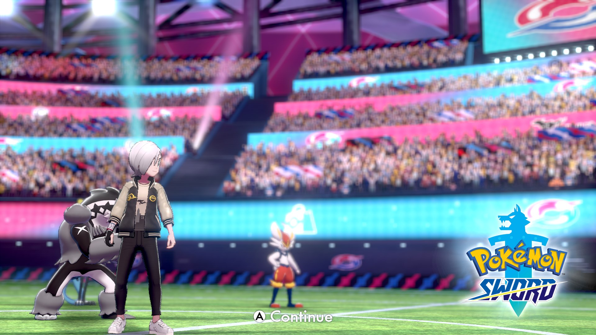
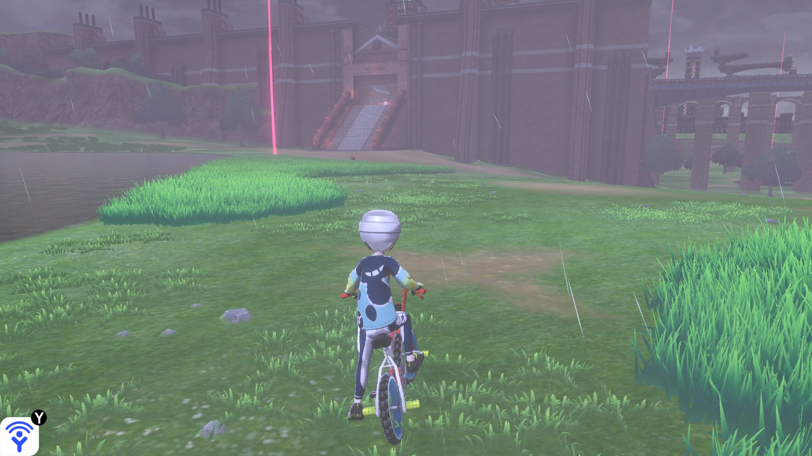
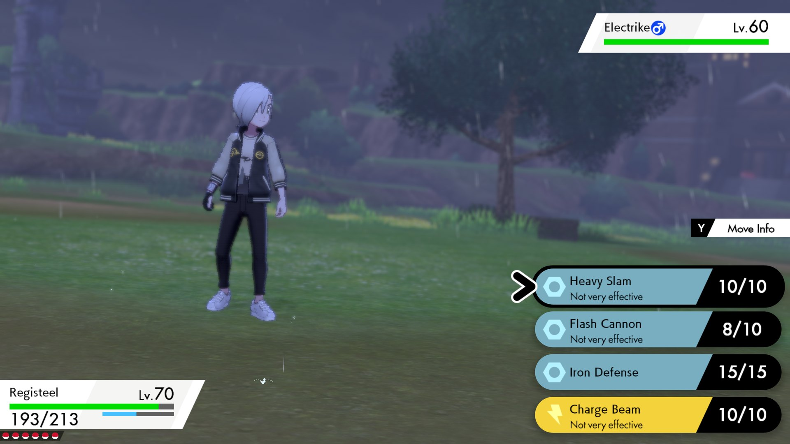
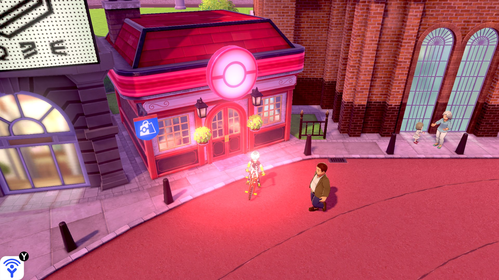

# SwSh Recomp

A native Windows port of **Pokémon Sword** and **Pokémon Shield** (Nintendo Switch), made by **static
recompilation**: the game's ARM64 code is translated into C and compiled for your PC, and a runtime stands in for the
Switch (system services, NVN graphics on Vulkan, audio, controllers). **It is not an emulator.** Built on
**[Let's Go Recomp](https://github.com/raulzrrs/letsgo-recomp)**, itself built on
**[LAS Recomp](https://github.com/peiikai/LASRecomp)** by Peiikai.

> [!IMPORTANT]
> **No game files are included.** You need your own legally obtained copy of *Pokémon Sword* or *Shield*, extracted
> (the `exefs` and `romfs` folders). This repository does not provide the game, its keys, or instructions on how to
> obtain them. A fan project, not affiliated with Nintendo, The Pokémon Company, Game Freak or Creatures.

> [!NOTE]
> **Work in progress.** Tested with *Sword* 1.3.2 and its Expansion Pass on one PC; *Shield* has **not been tested**
> yet, and the game hasn't been played from start to finish on this port. Bug reports, fixes and test results from
> other PCs are very welcome ([CONTRIBUTING.md](CONTRIBUTING.md)).

<table>
<tr>
<td></td>
<td></td>
</tr>
<tr>
<td></td>
<td></td>
</tr>
</table>

*Rendered by this port at 2560x1440 (not Switch captures).*

## Features

- Native code; any internal resolution (2560x1440 and up, supersampled on smaller screens), any window size,
  fullscreen
- **SMAA** anti-aliasing, **16x** anisotropic filtering, **FSR 1** to render below the window size
- The game's **30 fps**, or **60 fps** for the whole game (like the community's 60 fps patch; experimental)
- Keyboard and any controller
- The **Expansion Pass** (The Isle of Armor, The Crown Tundra) from your own DLC data
- Every shader of the game prepared for your GPU on the first start, then kept on disk; the vertex data of static models
  kept in video memory

Measured on a Core i5-14600KF with an RTX 3080 at 2560x1440 (the reports are in
[docs/engineering](docs/engineering/README.md)): the open world and towns hold **60 fps** once their shaders are built;
without the frame cap, about 90 to 120 fps.

## Requirements

| | |
|---|---|
| OS | Windows 10 or 11, 64-bit |
| CPU | x86-64 with AVX2, FMA and BMI2 (Intel Haswell / AMD Zen or newer) |
| GPU | Vulkan 1.3 |
| RAM | about 5 GB while playing |
| Disk | about 17 GB free (2 GB of it for the prepared shaders) |

## Supported games

- *Pokémon Sword* **1.3.2** (with the 1.3.2 update applied to the extracted files): the most tested
- the Expansion Pass DLC data (optional; set up by hand for now, see [Known issues](#known-issues))
- *Pokémon Shield*: recognized, **not tested** (no dump available here)
- `.xci` / `.nsp` files must be extracted first

## How to play

1. Download `SwShRecomp-<version>-windows.zip` from [Releases](../../releases) and unzip it into a folder you can
   write to (not inside Program Files).
2. Open **`SwShRecomp.exe`** (if Windows warns, **More info** → **Run anyway**).
3. Click **Select game folder...** and pick the folder with your extracted game (`exefs` and `romfs`).
4. Wait while it copies the files and recompiles the game for your PC. This happens only once and takes a while
   (about 20 minutes for the game code on a 20-thread CPU, longer with fewer threads).
5. Click **Play**.

Everything stays in that folder (settings in `larecomp.ini`, saves, shader caches, the log `lasrecomp.log`). To
update, unzip a new release over it.

**On the first start** the game's shaders are prepared for your GPU in the background (about 5 minutes on an 8-core
CPU; the title screen runs slower meanwhile, and the game is playable). After that a first visit to a place mostly just
links what was prepared; what isn't in the game files is still compiled when first seen, which can hitch for a moment.

## Known issues

- During the first start's shader preparation the game runs slower, and a few shaders (those not in the game files)
  still hitch the first time they are seen
- At 60 fps the crowd on the title screen flickers (an animation counted in frames)
- The Expansion Pass is not set up by the launcher yet: each DLC's RomFS has to be packed by hand into
  `extracted/aoc/<data id>.bin` ([docs/DIAGNOSTICO-SWSH.md](docs/DIAGNOSTICO-SWSH.md))
- Memory use grows slowly over long sessions (being investigated)
- Online features (raids with other players, trades, Y-Comm) are not supported

Crashes: please open an issue with `lasrecomp.log` ([CONTRIBUTING.md](CONTRIBUTING.md)). What changed in each
release: [CHANGELOG.md](CHANGELOG.md).

## Building from source

Step by step in [docs/COMPILAR-WINDOWS.md](docs/COMPILAR-WINDOWS.md) (in Portuguese). The technical documentation is
in [docs/engineering](docs/engineering/README.md) (architecture, runtime and graphics audits, performance baseline,
known issues, the study of how other Switch recomp ports handle shaders); how each problem was solved is in
[docs/HISTORICO.md](docs/HISTORICO.md). The history of the Let's Go port this one grew from is kept in
[docs/letsgo](docs/letsgo).

## Credits

- **[LAS Recomp](https://github.com/peiikai/LASRecomp)** by **Peiikai**: the recompiler and runtime this port is
  built on
- **[Let's Go Recomp](https://github.com/raulzrrs/letsgo-recomp)**: the Pokémon port this one was forked from
- Techniques studied in the other Switch recomp projects (OpenSmash, mk8-recomp, SuperMarioWonderRecomp, SkyRecomp,
  WindowSmash, HWDER, EoWRecomp): see [docs/engineering](docs/engineering/recomp-project-comparison.md)
- Libraries: SDL 3, FFmpeg (LGPL), Dear ImGui, Vulkan Memory Allocator, shaderc, SMAA, AMD FidelityFX FSR 1, the
  Baloo 2 font (OFL), Capstone, Unicorn, PyInstaller, Zig

## License

The code in this repository is under the [MIT license](LICENSE), like LAS Recomp; third-party components keep their
own licenses. It grants no rights to the game. *Pokémon*, *Pokémon Sword* and *Pokémon Shield* are trademarks of
their respective owners.
